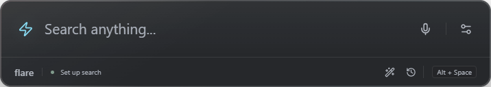
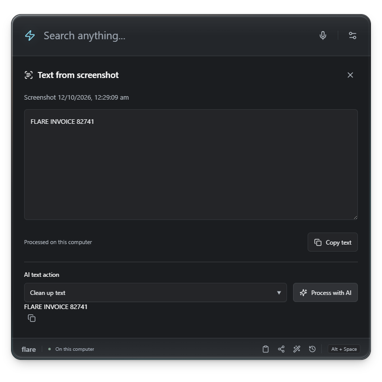
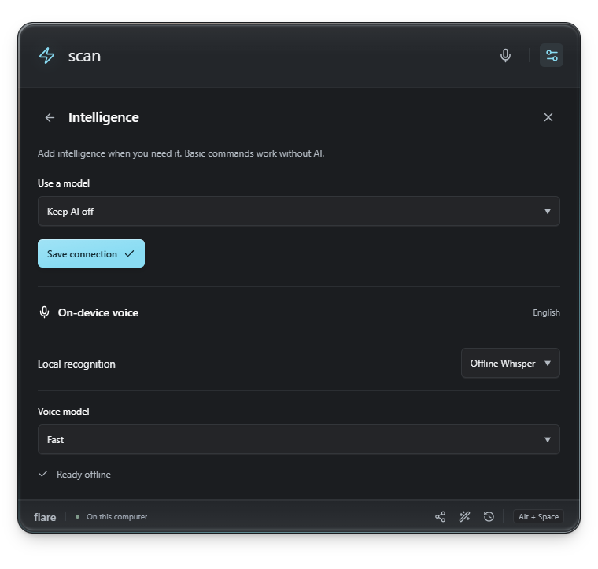

# Flare

**A keyboard and voice command center for Windows.**

Find files across drives, act on the selected result, and turn a short command into a useful action. A glass-inspired interface, local search, and optional intelligence in one launcher.

**Preview 0.1** | Windows 11 x64 | Local-first | MIT source



> Flare is a working preview, not a production-ready autonomous assistant. Builds are unsigned. No release is published automatically.

## What You Can Do

| Capability                      | What it does                                                                                                                                |
| ------------------------------- | ------------------------------------------------------------------------------------------------------------------------------------------- |
| Search                          | Apps, file names and locations, folders, bookmarks, settings, and calculations. Connected local drives are discovered automatically.        |
| Permission-based content search | Read supported documents only in folders you explicitly allow. Names and locations remain searchable without content access.                |
| Smart File Actions              | Format-aware actions for the selected file: preview, share, resize, convert, PDF page tools, summarize, or read text.                       |
| Local OCR                       | Recognize English text in images and scanned PDFs without uploading them. Optional content indexing runs after filename indexing.           |
| Voice                           | Windows English speech, optional offline Whisper, or explicitly enabled online transcription. Review the transcript before submitting.      |
| File tools                      | Image conversion/compression/resizing; images to PDF; PDF merge, split, page extraction, and image export. Review outputs and undo changes. |
| Quick Share                     | A temporary file link and QR code for a trusted local network. No hosted server or account required.                                        |
| Intelligence                    | Ask questions, interpret supported commands, and summarize approved documents using your chosen provider or local Ollama.                   |
| Appearance                      | Light/dark themes, optional glass treatment, coordinated transitions, and reduced-motion support.                                           |

Clipboard history is opt-in and captures text and screenshots automatically once enabled. It keeps up to 50 items: text for up to seven days, screenshots in bounded memory for the current app session only. Clear/disable controls and supported sensitive-content markers are respected.

## Install

Use a locally generated setup executable in `release/`, or extract the **entire** portable ZIP. A public download is not currently promised by this repository.

### Setup Choices

The full installer bundles the optional engines and model files. It asks which features to keep:

| Component                     | Installation choice                                                               |
| ----------------------------- | --------------------------------------------------------------------------------- |
| Smart File Actions            | Enabled by default; can be deselected.                                            |
| Local OCR                     | Optional. Includes the English recognition data.                                  |
| Offline Whisper               | Optional. Choose **Fast** (tiny.en) or **Balanced** (base.en).                    |
| Microsoft C++ support runtime | Separate opt-in for Whisper's native dependency; Microsoft's license terms apply. |

No model download is needed during installation. Declined OCR/voice payloads are removed before setup finishes. Installing a component **does not** grant access to file contents or your microphone. To add a declined component later, rerun setup.

### Portable Mode

Extract the whole ZIP and run `Flare Portable.cmd`. Settings and recovery files stay in `FlareData` beside the app. Keep that folder and the bundled resources together.

Running `Flare.exe` directly uses per-user storage unless launched with `--portable`. Portable builds include optional payloads, but OCR and offline voice remain off until enabled in Settings. Startup registration is disabled in portable mode.

Unsigned builds may trigger Windows SmartScreen. Restore cleanup files before deleting application data.

## Everyday Use

| Shortcut                        | Action                                                                                             |
| ------------------------------- | -------------------------------------------------------------------------------------------------- |
| `Alt+Space`                     | Open the launcher.                                                                                 |
| Hold `Alt+Space` for one second | Open voice input.                                                                                  |
| Arrow keys / `Enter`            | Navigate / open the selected result.                                                               |
| `Ctrl+Space`                    | Preview the selected result.                                                                       |
| `Escape`                        | Hide Flare and cancel microphone/AI input. Ongoing file operations are not cancelled by dismissal. |

Voice uses silence-stop by default; push-to-talk is available in Settings.

### Example Commands

```text
open YouTube
volume max
brightness 50 percent
bightness 100
12 * (3 + 4)
find photos from June 2025
search drives D and E for invoice
play Dil Mera by Yashraj on Spotify
```

Basic commands tolerate conservative spelling corrections without calling AI. Brightness support depends on the display; external-monitor DDC control is not implemented.

Music lookup prefers a registered player and otherwise opens a resolved web track. Apple Music catalogue lookup needs no credentials; Spotify mapping is best-effort. If a track cannot be resolved, Flare opens Google with the original submitted query. Opening a track **does not guarantee autoplay** or bypass a subscription.

### File Workflows

Select a file and open its actions. Available operations follow its format rather than offering unsupported tools.

Enable Clipboard history, copy a screenshot, then open the Clipboard tab. Preview it, copy it back, or choose **Read screenshot text** for local OCR. Screenshot pixels are not saved to disk, and clearing/disabling history or restarting Flare removes them.

With Intelligence connected, extracted text also offers **Summarize**, **Clean up text**, and **Extract action items**. Cloud processing asks permission, sends only a bounded text excerpt (not the image), and preserves the original OCR result. AI corrections can still be wrong; verify important names, dates, and amounts.



Conversions create new copies. Organization and older-file cleanup use reviewed plans, a durable history, and Undo. Cleanup candidates are based on age, not a claim that a file is unused. Balanced trust can skip an extra conversion-output review, never move/cleanup approval.

Undo skips files edited afterward or occupied original locations. It cannot restore missing recovery files. Recovery does not expire automatically; deleting application data can destroy recovery availability.

## Privacy and Permissions

| Operation             | Boundary                                                                                                                                           |
| --------------------- | -------------------------------------------------------------------------------------------------------------------------------------------------- |
| Filename indexing     | Names and locations on connected local drives. Protected, hidden/system, linked, cloud-only, credential, and common cache locations stay excluded. |
| Content indexing      | Only explicitly allowed folders. Revoking permission removes their indexed content.                                                                |
| Read text             | Local OCR with session-level file consent when needed; does not silently add the file's contents to search.                                        |
| Clipboard screenshots | Opt-in automatic capture; session-only pixels capped at 12 MB per image and 32 MB total. No automatic OCR or upload.                               |
| AI text actions       | Explicit processing request and cloud consent; at most 16,000 extracted characters, no screenshot pixels, no executable output.                    |
| OCR indexing          | Separately enabled, local-only, and restricted to content-allowed folders. Disabling OCR removes OCR-generated search text.                        |
| Ordinary AI request   | Sends command/question text, not the indexed contents of your files.                                                                               |
| Document summary      | Requires file-level consent or an explicit assistant-folder grant before sending an excerpt to the selected provider.                              |
| Online voice          | Separately opt-in; sends the recording to the selected speech provider.                                                                            |
| Offline Whisper       | Runs locally and never falls back to uploading audio. Temporary recognition files are removed after the request.                                   |
| Quick Share           | Approved, unencrypted HTTP on your trusted local network; links expire after ten minutes and can be stopped sooner.                                |

API keys use Windows-backed Electron `safeStorage` and are not returned to the renderer. No account, hosted database, or mandatory AI provider is required.

Flare does not execute arbitrary AI-generated shell commands or allow AI permanent deletion. File instructions are data, not executable actions.

Read the [file-access guide](docs/FILE_ACCESS.md) for permission details. Use Quick Share only on a network you trust; cross-device access can depend on Windows Firewall and network configuration.

## Intelligence and Voice Setup

Enable Intelligence in Settings and connect a supported provider. Gemini, OpenRouter, OpenAI, Anthropic, and local Ollama are supported; Groq is available for Whisper transcription. Speech and intelligence models are selected separately.

- **OpenRouter:** discovers compatible zero-price text models and offers Automatic (free models). Paid routes are blocked; provider rate limits and availability still apply.
- **Gemini:** discover account models, select one, then use Test response to verify generation. Check connection only tests model discovery, not quota or generation availability.
- **Ollama:** links to its official installer, detects local models, and offers an explicitly approved compact-model download. Nothing downloads automatically.
- **Windows speech:** requires an installed English speech pack.
- **Offline Whisper:** select it during setup, then choose it under Local recognition. Fast is smaller; Balanced can improve accuracy at a higher memory/CPU cost.
- **Online transcription:** optional OpenAI, Gemini, or Groq routing. Review the recorded input/transcript and the provider's charges before enabling it.

Consumer ChatGPT, Claude, and Gemini subscriptions are **not assumed to include API credits**. Provider calls may be billable. Connection tests do not make a generation request; Test response asks before doing so.

When enabled Intelligence has no local result, Flare offers Ask AI. Responses appear progressively and respect reduced motion. Ordinary failed requests can fall back to Google; local searches and denied file access do not. Nothing searches online just from typing, and cancellation does not trigger fallback.

Normal text requests retry HTTP 503 up to twice with bounded backoff. Attempts can count toward usage. Speech uploads and connection tests are not automatically retried.

Setup guides: [Gemini and voice](docs/GEMINI_AND_VOICE.md), [Windows, offline Whisper, and Groq voice](docs/VOICE_WHISPER.md), [free AI and music](docs/FREE_AI_AND_MUSIC.md).



## Build From Source

Use Windows with Node.js 24 or later and npm.

```powershell
npm ci
npm run assets
npm run build
npm start
```

For live desktop development:

```powershell
npm run desktop:dev
```

`npm run dev` is a browser-only UI preview without native search, file access, or speech.

### Package Setup and Portable Builds

```powershell
npm run package
```

This generates an NSIS installer and portable ZIP in `release/`. The first build needs internet to obtain dependencies, packaging tools, optional voice models, and the signed Microsoft support installer.

`npm run payloads` prepares and verifies optional payloads separately. Models and native Whisper binaries are pinned and checksum-verified; the Microsoft installer is signature-verified. Payloads are cached in ignored `Files/private/`, not committed to GitHub.

**Before publishing binaries:** review all dependency/model licenses and Microsoft's runtime redistribution requirements. Bundling a signed installer does not itself establish redistribution rights.

### Test

```powershell
npm test
npm run test:local-features
npm run test:voice
npm run test:settings-motion
npm run test:launch-motion
npm run format:check
```

Additional workflow suites are listed in [verification](docs/verification.md) and `package.json`. Close any running Flare instance before native UI tests to release the global shortcut.

Desktop tests use isolated data, generated fixtures, and mocked chooser/provider responses where noted. They do not read your personal files or establish human speech accuracy. Set `FLARE_SMOKE_EXE` to an absolute packaged `Flare.exe` path to run supported suites against the distributed app.

## Architecture

Electron owns native windows, shortcuts, permissions, IPC, and approved file operations. React/TypeScript renders the interface. Workers handle indexing, OCR, conversion, and search. SQLite stores the local index and operation history.

See [architecture](docs/architecture.md), [capabilities](docs/capabilities.md), and [verification](docs/verification.md). Private prompts, references, payload caches, and test evidence belong in ignored `Files/private/`. Do not force-add them.

## Current Limits

- Windows 11 x64 is the initial target; voice commands and OCR are English-only.
- OCR accepts inputs up to 12 MB, processes at most the first ten PDF pages, and caps output at 160,000 characters.
- Speech accuracy varies with microphones, accents, noise, and hardware. Synthetic tests are not a substitute for human testing.
- Conversion supports specific formats; it is not a universal converter.
- Large indexes, malformed/encrypted documents, disconnecting drives, scaling/accessibility, and clean-machine installation need more validation.
- Runtime dependency advisories and unsigned distribution remain public-release concerns; see the verification guide.
- Open-window search is deferred. Flare is not a general browser-automation agent.

## Contributing

Start with a reproducible issue: Windows version, app version, steps, expected behavior, and relevant redacted logs. Never include API keys, personal documents, or private test data.

Keep changes focused, add tests for changed behavior, and preserve permission checks and Undo safeguards. Visual changes should also cover compact layouts, keyboard use, and reduced motion.

## License and Credits

Flare source is [MIT](LICENSE). Dependencies, model weights, and redistributed components have separate terms: [third-party notices](THIRD_PARTY_NOTICES.md).

Developed by **Akshat96af**.
